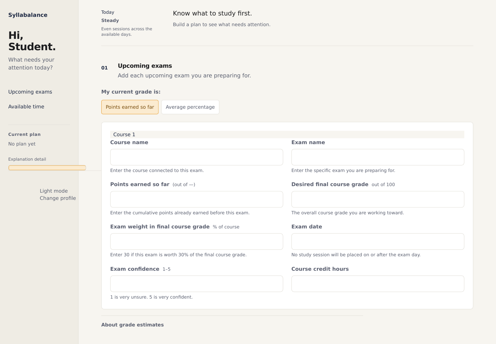
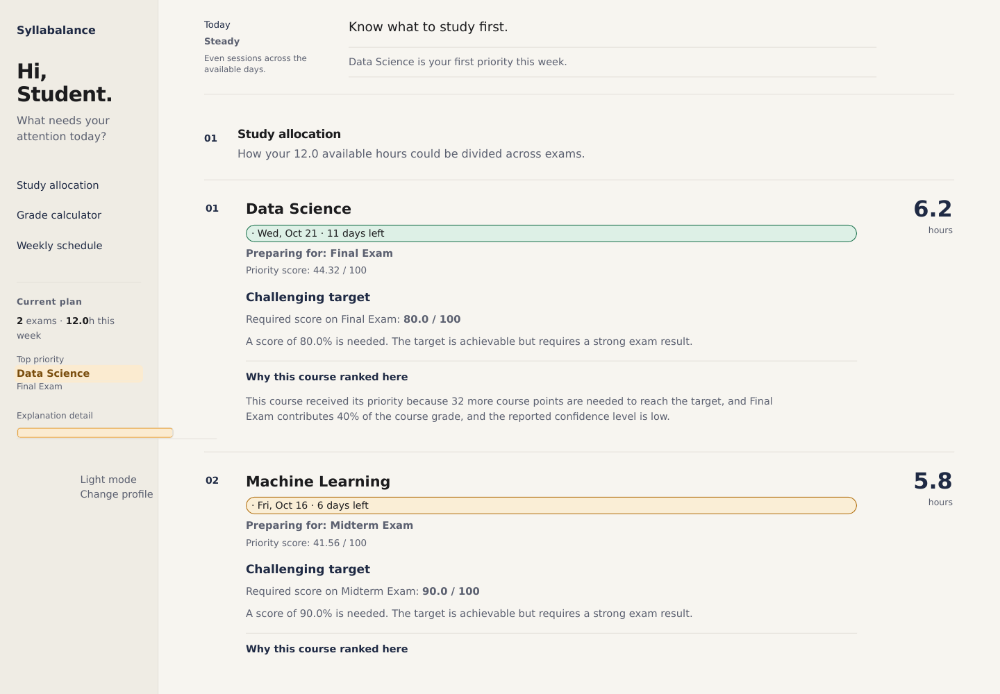

# Syllabalance

Syllabalance is a Flask-based exam-planning tool that helps students decide where their limited study time should go.

Instead of simply tracking exam dates, it considers grade gaps, exam weight, urgency, confidence, course credit hours, and weekly availability. It then ranks competing course priorities, explains the ranking, and produces a realistic study schedule.

## What the application does

- Accepts multiple upcoming exams, with each exam entered as a separate item.
- Ranks courses using an explainable priority model.
- Allocates a limited number of weekly study hours.
- Checks whether a target grade is mathematically reachable.
- Calculates the exam score required to reach a target using cumulative-points or percentage grading.
- Lets students test possible exam outcomes.
- Builds a deadline-safe seven-day study schedule using Steady, Front-loader, or Deadline-driven distribution.
- Generates up to three plan-based nudges ordered by urgency.
- Explains why each course received its ranking.
- Supports light and dark themes.
- Stores interface preferences locally in the browser.
- Does not permanently store entered course information.

## Running the application

### Windows quick start

1. Download or clone the repository.
2. Open the project folder.
3. Double-click `OPEN_SYLLABALANCE.bat`.
4. Keep the command window open while using the application.

The application will open at:

```text
http://127.0.0.1:5050
```

### Standard setup

```powershell
py -m venv .venv
.venv\Scripts\activate
py -m pip install -r requirements.txt
py app.py
```

Then open:

```text
http://127.0.0.1:5000
```

## Understanding the inputs

### Current grade mode

In **Points earned so far** mode, enter the cumulative course points already earned. The maximum is `100 - exam weight`. For example, when coursework is worth 70 points and the final is worth 30, enter `60` if 60 course points have already been earned.

In **Average percentage** mode, enter the percentage average across coursework completed before the exam.

### Target course grade

The overall grade the student wants to achieve by the end of the course, out of 100.

### Exam weight

How much the upcoming exam contributes to the final course grade.

For example, enter `30` if the exam is worth 30% of the course total.

### Exam date

The calendar date of the exam. The scheduler never places a study session on or after this date.

### Confidence level

A self-reported value from 1 to 5:

- `1` means very low confidence.
- `3` means moderate confidence.
- `5` means very high confidence.

Lower confidence can increase the course's study priority.

### Course credit hours

The official credit value of the course.

### Available study hours

The total number of hours the student can realistically study during the selected week.

## How the planning process works

Syllabalance uses several stages:

1. It validates the course and exam information entered by the student.
2. It calculates a priority score for each course.
3. It compares urgency, academic impact, grade gap, confidence, and course load.
4. It checks whether the target grade is mathematically reachable through the upcoming exam.
5. It distributes the available study time across the ranked courses.
6. It converts those allocations into manageable sessions across seven days.
7. It generates plain-language explanations for the recommendations.

The application is intended to support student decisions. Its output is a recommendation, not a guarantee of a particular academic result.

## Main features

### Explainable course ranking

Each recommendation includes a short explanation describing the factors that influenced the course's position.

### Target feasibility analysis

The application calculates the exam score required to reach the target grade and identifies targets that are currently:

- Within reach
- Challenging
- High risk
- Mathematically impossible through the upcoming exam alone

### Exam what-if calculator

Students can adjust a possible exam score and immediately see:

- The projected overall course grade
- The change from the current grade
- Whether the selected target would be reached

### Constrained study-hour allocation

Available hours are distributed across competing courses while ensuring that the total recommendation does not exceed the student's stated availability.

### Weekly schedule

The scheduling engine divides allocated time into study sessions across seven days while respecting the selected daily limit and every exam date. The study-style preference changes how those sessions are distributed.

## Running the tests

```powershell
py -m pytest
```

## Screenshots

### Exam setup



### Generated study plan



## Technology

- Python
- Flask
- SciPy
- HTML
- CSS
- JavaScript
- Jinja
- pytest
- Gunicorn

## Project structure

```text
Syllabalance/
├── app.py
├── nudge_engine.py
├── priority_engine.py
├── schedule_engine.py
├── OPEN_SYLLABALANCE.bat
├── requirements.txt
├── README.md
├── screenshots/
│   ├── exam-setup.png
│   └── study-plan.png
├── static/
│   └── style.css
├── templates/
│   └── index.html
├── tests/
│   ├── test_app.py
│   ├── test_nudge_engine.py
│   ├── test_palette.py
│   ├── test_priority_engine.py
│   └── test_schedule_engine.py
```
